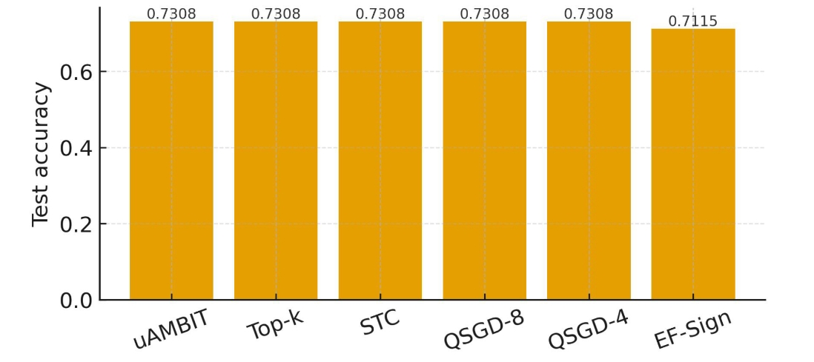
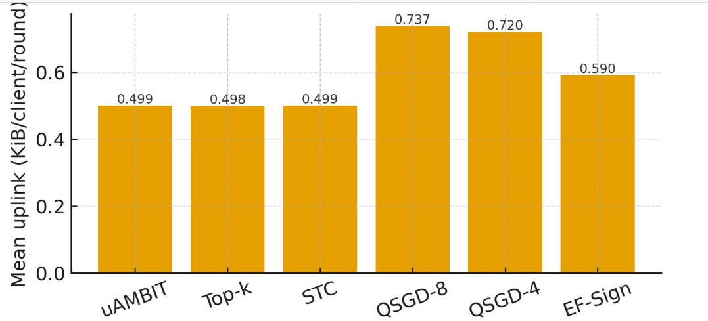

# UAMBIT: Hard-Cap Federated Compression with Predictable Uplink

[](https://colab.research.google.com/github/emadhammami/uambit-hard-cap-fl/blob/main/notebooks/uambit_budget_cap.ipynb)

This repository explores byte-budgeted federated update compression using threshold search, sign-and-scale encoding, and error feedback.

## Repository scope

This repository provides a BreastMNIST demonstration and modular research code for byte-budgeted federated update compression. It is not a complete release of all experimental implementations, datasets, or variants evaluated in the broader uAMBIT research study. The figures and numerical results below describe the included BreastMNIST demonstration; they are not independent reproduction of every result in the published paper.

---

## BreastMNIST demonstration (0.5 KiB budget)

| Method | Uplink (KiB) | Std (bytes) | Test Acc |
|---|---:|---:|---:|
| **UAMBIT (ours)** | **0.499** | **0.8** | **0.7308** |
| Top-k (budgeted) | 0.498 | 1.0 | 0.7308 |
| STC (budgeted) | 0.499 | 0.6 | 0.7308 |
| QSGD-8 | 0.737 | 2.3 | 0.7308 |
| QSGD-4 | 0.720 | 2.9 | 0.7308 |
| EF-Sign | 0.590 | 1.5 | 0.7115 |

In this configuration, several methods have identical test accuracy (0.7308); the table does not establish an accuracy advantage. QSGD-8, QSGD-4, and EF-Sign also exceed the 0.5 KiB reference budget in these results.






---

## How this repo is organized

The repository contains a Colab notebook and a separate modular implementation for BreastMNIST:

### Modular implementation

- Core code under `src/uambit_cap/`:
  - `compressors.py` — uAMBIT, Top-k(DGC), STC, QSGD-8/4, EF-Sign
  - `model_data.py` — LeNet-5 (fixed pooling) + BreastMNIST loader
  - `experiment.py` — training loop, plotting, runners
  - `utils.py` — packing, flatten/unflatten, seeds, etc.
- Runner: `notebooks/scripts/run_all.py` (writes figures).
- **Outputs (figures only):** `plots/` by default.

### Colab notebook

The experiment notebook is available at:

- **[`notebooks/uambit_budget_cap.ipynb`](./notebooks/uambit_budget_cap.ipynb)**

The notebook includes the training and plotting workflow.

---

## Quickstart

### Colab
Open the badge above to open `notebooks/uambit_budget_cap.ipynb`. See the notebook for its output paths.

### Local
```bash
pip install -r requirements.txt
PYTHONPATH=src python notebooks/scripts/run_all.py
# figures will be written to: plots/
```
